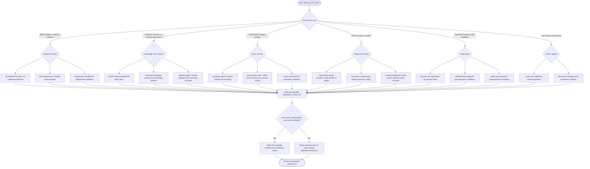

# Personal Plugin Archive

This repository tracks plugin packages owned by the connected Plugin Creator registry. It is not a mirror of every upstream project's complete runtime source code.

## Current inventory

- Plugin Creator registry inventory: 102 personal plugins (checked 2026-11-01).
- Package directories in this branch: 102.
- Package directories still missing: 0. All packages are present; see [inventory/README.md](inventory/README.md) for completeness and README status.

## Plugin index

- [aceternity-ui](plugins/aceternity-ui/)
- [agent-reach-guide](plugins/agent-reach-guide/)
- [ai-labs-workflows](plugins/ai-labs-workflows/)
- [ai-video-storyboard](plugins/ai-video-storyboard/)
- [animejs-motion](plugins/animejs-motion/)
- [antigravity-awesome-skills](plugins/antigravity-awesome-skills/)
- [api-anything](plugins/api-anything/)
- [archify-diagrams](plugins/archify-diagrams/)
- [arena-skill](plugins/arena-skill/)
- [artemis-android-qa](plugins/artemis-android-qa/)
- [beyondseo](plugins/beyondseo/)
- [blender-mcp-studio](plugins/blender-mcp-studio/)
- [brag-launch-video](plugins/brag-launch-video/)
- [browser-use-automation](plugins/browser-use-automation/)
- [build-your-own-x-guide](plugins/build-your-own-x-guide/)
- [career-ops-copilot](plugins/career-ops-copilot/)
- [caveman](plugins/caveman/)
- [chart-visualization-studio](plugins/chart-visualization-studio/)
- [chrome-devtools-agent](plugins/chrome-devtools-agent/)
- [claude-mem-adapter](plugins/claude-mem-adapter/)
- [claudex-loop-assistant](plugins/claudex-loop-assistant/)
- [codex-security-advisor](plugins/codex-security-advisor/)
- [comfyui-workflow-studio](plugins/comfyui-workflow-studio/)
- [context7-documentation](plugins/context7-documentation/)
- [cosyvoice-studio](plugins/cosyvoice-studio/)
- [customer-pain-point-research](plugins/customer-pain-point-research/)
- [design-md-guide](plugins/design-md-guide/)
- [diagram-design](plugins/diagram-design/)
- [easyui](plugins/easyui/)
- [ecc-engineering-companion](plugins/ecc-engineering-companion/)
- [engineer-workflow-skills](plugins/engineer-workflow-skills/)
- [ffmpeg-production-engine](plugins/ffmpeg-production-engine/)
- [firecrawl-toolkit](plugins/firecrawl-toolkit/)
- [front-end](plugins/front-end/)
- [frontend-design-studio](plugins/frontend-design-studio/)
- [graphify-agent](plugins/graphify-agent/)
- [gstack-workflow-toolkit](plugins/gstack-workflow-toolkit/)
- [hallmark-design](plugins/hallmark-design/)
- [harness-engineering](plugins/harness-engineering/)
- [harvey-sales-operator](plugins/harvey-sales-operator/)
- [humanizer](plugins/humanizer/)
- [ian-xiaohei-illustrations](plugins/ian-xiaohei-illustrations/)
- [impeccable-design-workflow](plugins/impeccable-design-workflow/)
- [inbox-intelligence](plugins/inbox-intelligence/)
- [jolt-physics-simulator](plugins/jolt-physics-simulator/)
- [kobra-systems](plugins/kobra-systems/)
- [librosa-audio-intelligence](plugins/librosa-audio-intelligence/)
- [loop-engineering](plugins/loop-engineering/)
- [losslesscut-editor](plugins/losslesscut-editor/)
- [lottie-animator](plugins/lottie-animator/)
- [manim-explainer](plugins/manim-explainer/)
- [mirofish-simulation-guide](plugins/mirofish-simulation-guide/)
- [ml-data-quality-labeling](plugins/ml-data-quality-labeling/)
- [ml-engineering-suite](plugins/ml-engineering-suite/)
- [ml-hyperparameter-optimization](plugins/ml-hyperparameter-optimization/)
- [ml-model-deployment](plugins/ml-model-deployment/)
- [ml-model-development](plugins/ml-model-development/)
- [mlops-pipeline-engineer](plugins/mlops-pipeline-engineer/)
- [motion-ui-studio](plugins/motion-ui-studio/)
- [natural-copy-editor](plugins/natural-copy-editor/)
- [not-ai](plugins/not-ai/)
- [obs-capture-studio](plugins/obs-capture-studio/)
- [obsidian-second-brain](plugins/obsidian-second-brain/)
- [omniroute-operator](plugins/omniroute-operator/)
- [openviking-context-plugin](plugins/openviking-context-plugin/)
- [overleaf-helper](plugins/overleaf-helper/)
- [pentagi-security-workflow](plugins/pentagi-security-workflow/)
- [pinui](plugins/pinui/)
- [placement-intelligence](plugins/placement-intelligence/)
- [postprocessing-fx](plugins/postprocessing-fx/)
- [primary-source-verifier](plugins/primary-source-verifier/)
- [prompt-master](plugins/prompt-master/)
- [pya-security-audit](plugins/pya-security-audit/)
- [qa-quality-agent](plugins/qa-quality-agent/)
- [rareui](plugins/rareui/)
- [rea-reverse-engineering](plugins/rea-reverse-engineering/)
- [remotion-skills](plugins/remotion-skills/)
- [remotion-studio](plugins/remotion-studio/)
- [reticle-verification](plugins/reticle-verification/)
- [ruflo-agent-harness](plugins/ruflo-agent-harness/)
- [scientific-agent-skills-workflow](plugins/scientific-agent-skills-workflow/)
- [serena-coding-agent](plugins/serena-coding-agent/)
- [skill-inspector](plugins/skill-inspector/)
- [slopmonster-writing-review](plugins/slopmonster-writing-review/)
- [social-content-planner](plugins/social-content-planner/)
- [superpowers-workflow](plugins/superpowers-workflow/)
- [taste-skill](plugins/taste-skill/)
- [tencentdb-agent-memory](plugins/tencentdb-agent-memory/)
- [three-gpu-pathtracer](plugins/three-gpu-pathtracer/)
- [three-quarks-vfx](plugins/three-quarks-vfx/)
- [threejs-studio](plugins/threejs-studio/)
- [trend-discovery-last30days](plugins/trend-discovery-last30days/)
- [tweakpane-controls](plugins/tweakpane-controls/)
- [unslop-ui-design](plugins/unslop-ui-design/)
- [vercel-skills-workflow](plugins/vercel-skills-workflow/)
- [web-recon-toolkit](plugins/web-recon-toolkit/)
- [weknora-knowledge-assistant](plugins/weknora-knowledge-assistant/)
- [wellfound-auto-apply](plugins/wellfound-auto-apply/)
- [wensity-ui-assistant](plugins/wensity-ui-assistant/)
- [whisperx-caption-studio](plugins/whisperx-caption-studio/)
- [x-account-readonly-assistant](plugins/x-account-readonly-assistant/)
- [x-post-analytics](plugins/x-post-analytics/)

The full Plugin Creator inventory is tracked in [inventory/README.md](inventory/README.md).

## Choose a plugin by topic and use case

Use this decision flow to route a task to the most relevant archived plugin. Start with the outcome you need, then choose the matching topic. The named plugins are examples from this inventory; check each package's own instructions and dependencies before use.

### Topic-to-use-case quick guide

| Topic | Example use case | Start with |
|---|---|---|
| Software engineering | Implement a feature, debug code, or improve a development workflow | `ml-engineering-suite`, `ml-model-development`, `loop-engineering` |
| Documentation and knowledge | Find current library guidance or organize retrieved knowledge | `context7-documentation`, `weknora-knowledge-assistant` |
| Diagrams and architecture | Map dependencies, concepts, or system structure | `graphify-agent`, `archify-diagrams`, `diagram-design` |
| QA and testing | Plan test coverage or review an app's behavior | `qa-quality-agent`, `artemis-android-qa`, `reticle-verification` |
| Security | Audit code or structure a security review | `pya-security-audit`, `codex-security-advisor`, `pentagi-security-workflow` |
| UI and visual design | Improve interface consistency and design decisions | `impeccable-design-workflow`, `taste-skill`, `design-md-guide` |
| Writing and media | Review prose or plan video content | `humanizer`, `slopmonster-writing-review`, `ai-video-storyboard` |
| Browser and job automation | Automate browser tasks or organize job-application workflows | `browser-use-automation`, `wellfound-auto-apply` |
| Career and placement | Track career tasks or research placement opportunities | `career-ops-copilot`, `placement-intelligence` |
| Deployment and DevOps | Follow deployment-focused workflows | `vercel-skills-workflow`, `mlops-pipeline-engineer` |

These are routing suggestions based on package names and inventory topics, not guarantees of capability. Confirm each package's `SKILL.md`, manifest, permissions, dependencies, and supported inputs before selecting it. If multiple topics apply, use the narrowest task-specific package first and add supporting packages only when needed.

## Scope and limitations

- Each folder contains the files available through the Plugin Creator package-file interface. These can include manifests, skill instructions, references, support scripts, and assets.
- Upstream repositories remain the source of truth for runtime implementation, dependencies, release history, and files not included in a plugin package.
- Do not commit credentials, API tokens, `.env` files, or other secrets.
- Do not fabricate unavailable binary assets. Restore them from an authoritative package/source distribution or mark them as unavailable.
- Verify each package's license and attribution requirements before redistribution. Presence in this archive does not establish redistribution rights.
- A package inventory can be complete at the directory level and still omit assets that are not accessible through the registry's text-file interface.

## Quality checks

Manual structural snapshot (2026-11-01): 102 package directories; 51 lack README.md; 3 legacy packages use manifest.json rather than plugin.json. No GitHub Actions workflow or repository archive validator was found on main, so automated CI could not be run. Passing structural checks does not prove runtime behavior. See [inventory/README.md](inventory/README.md).

