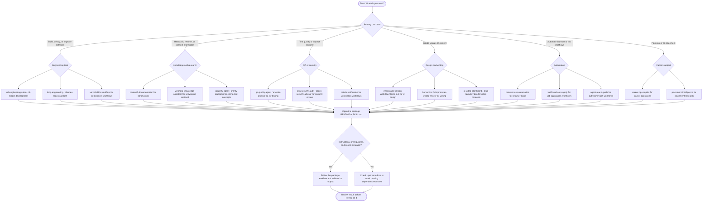

# Personal Plugin Archive

This repository tracks plugin packages and agent skills across **OpenAI / Codex**, **Claude**, and **Google Gemini / Antigravity**. It provides organized, discoverable bundles of skills, manifests, documentation, and tools for modern AI developer platforms.

## Current inventory

- **Total package directories in this repository:** 126
  - **Plugin Creator registry archive:** 104 personal plugins (under [`plugins/`](plugins/)).
  - **Google Gemini / Antigravity suite:** 22 native plugins (under [`gemini/`](gemini/)).
- **Package directories missing:** 0. One legacy binary asset remains missing from `not-ai` (`assets/composer-icon.png`); see [inventory/README.md](inventory/README.md) for file-level status.

---

## Gemini / Antigravity plugins

The [`gemini/`](gemini/) directory contains 22 production plugins tailored for **Google Gemini / Antigravity**, complete with manifests, skills, references, and documentation:

| Plugin | Use case & Highlights | Directory |
|---|---|---|
| **Android CLI** | Android Virtual Devices, UI layouts, screen mirroring, and Jetpack Compose previews | [`gemini/android-cli-plugin`](gemini/android-cli-plugin/) |
| **Chrome DevTools** | Browser automation, accessibility (a11y) auditing, and Core Web Vitals optimization via Puppeteer | [`gemini/chrome-devtools-plugin`](gemini/chrome-devtools-plugin/) |
| **Cloudflare** | Workers, Durable Objects, Agents SDK, R2, D1, KV, Basin, and framework deployments | [`gemini/cloudflare`](gemini/cloudflare/) |
| **Context7** | Up-to-date documentation and code examples for modern libraries and frameworks | [`gemini/context7`](gemini/context7/) |
| **Firebase** | Cloud Firestore, Security Rules, Firebase Auth, App Hosting, Data Connect, and Crashlytics | [`gemini/firebase`](gemini/firebase/) |
| **Google Calendar** | Calendar events, scheduling conflicts, availability checks, and RSVPs | [`gemini/gcalendar`](gemini/gcalendar/) |
| **Google Docs** | Docs creation, formatting, smart chips, tables, and markdown export/sync | [`gemini/gdocs`](gemini/gdocs/) |
| **Google Drive** | File browsing, search, upload, permissions, and sharing | [`gemini/gdrive`](gemini/gdrive/) |
| **Gemini API** | Gemini Interactions API, Decisions API, Live API, and multimodal streaming | [`gemini/gemini-api`](gemini/gemini-api/) |
| **Gmail** | Email search, thread management, message drafting, attachments, and labels | [`gemini/gmail`](gemini/gmail/) |
| **Google Antigravity SDK** | Autonomous AI agent and multi-agent swarm orchestration with AGY Python SDK | [`gemini/google-antigravity-sdk`](gemini/google-antigravity-sdk/) |
| **Google Sheets** | Spreadsheet data, formulas, charts, cell formatting, and CSV sync | [`gemini/gsheets`](gemini/gsheets/) |
| **Google Slides** | Presentation deck creation, slide drafting, and formatting | [`gemini/gslides`](gemini/gslides/) |
| **Headroom** | Intelligent context compression, retrieval, and token efficiency optimization | [`gemini/headroom`](gemini/headroom/) |
| **Mobbin** | Search 600,000+ real app UI screens and evidence-based screen redesign | [`gemini/mobbin`](gemini/mobbin/) |
| **Modern Web Guidance** | Modern web standards, responsive UI, dialogs/popovers, and Manifest V3 extensions | [`gemini/modern-web-guidance-plugin`](gemini/modern-web-guidance-plugin/) |
| **Notion** | Notion workspace management, knowledge capture, database design, and specs | [`gemini/notion`](gemini/notion/) |
| **Plugin Repository Toolkit** | Tool discovery, GitHub-to-agent skill converter, and repository auditing | [`gemini/plugin-repository-toolkit`](gemini/plugin-repository-toolkit/) |
| **Supabase** | Database design, migrations, RLS security policies, Auth, Edge Functions, and Postgres best practices | [`gemini/supabase`](gemini/supabase/) |
| **TestMu AI** | Evaluate, red-team, regression-test, and benchmark AI agents using Rook | [`gemini/testmu-ai`](gemini/testmu-ai/) |
| **Vercel** | Next.js, Vercel AI SDK, deployments, edge compute, React best practices, and Vercel MCP | [`gemini/vercel-plugin`](gemini/vercel-plugin/) |
| **VibeWise** | Learning-first AI pair programming with human-in-the-loop checkpoints (Build, Design, Implementation) | [`gemini/vibe-wise`](gemini/vibe-wise/) |

### Installing Gemini plugins

Install any plugin globally or per workspace in Google Antigravity:

```bash
# Global installation (available across all projects):
cp -r gemini/<plugin-name> ~/.gemini/config/plugins/

# Project-scoped installation:
mkdir -p .agents/plugins
cp -r gemini/<plugin-name> .agents/plugins/
```

See [gemini/README.md](gemini/README.md) for full details.

---

## Plugin index

The [`plugins/`](plugins/) directory tracks 104 personal packages from the Plugin Creator registry:

- [aceternity-ui](plugins/aceternity-ui/)
- [agent-reach-guide](plugins/agent-reach-guide/)
- [ai-labs-workflows](plugins/ai-labs-workflows/)
- [ai-video-storyboard](plugins/ai-video-storyboard/)
- [animejs-motion](plugins/animejs-motion/)
- [antigravity-awesome-skills](plugins/antigravity-awesome-skills/)
- [api-anything](plugins/api-anything/)
- [archify-diagrams](plugins/archify-diagrams/)
- [arena-skill](plugins/arena-skill/)
- [artemis-android-qa](plugins/artemis-android-qa/)
- [beyondseo](plugins/beyondseo/)
- [blender-mcp-studio](plugins/blender-mcp-studio/)
- [brag-launch-video](plugins/brag-launch-video/)
- [browser-use-automation](plugins/browser-use-automation/)
- [build-your-own-x-guide](plugins/build-your-own-x-guide/)
- [career-ops-copilot](plugins/career-ops-copilot/)
- [caveman](plugins/caveman/)
- [chart-visualization-studio](plugins/chart-visualization-studio/)
- [chrome-devtools-agent](plugins/chrome-devtools-agent/)
- [claude-mem-adapter](plugins/claude-mem-adapter/)
- [claudex-loop-assistant](plugins/claudex-loop-assistant/)
- [codex-security-advisor](plugins/codex-security-advisor/)
- [comfyui-workflow-studio](plugins/comfyui-workflow-studio/)
- [context7-documentation](plugins/context7-documentation/)
- [cosyvoice-studio](plugins/cosyvoice-studio/)
- [customer-pain-point-research](plugins/customer-pain-point-research/)
- [design-md-guide](plugins/design-md-guide/)
- [diagram-design](plugins/diagram-design/)
- [easyui](plugins/easyui/)
- [ecc-engineering-companion](plugins/ecc-engineering-companion/)
- [educator-public-profile-research](plugins/educator-public-profile-research/)
- [engineer-workflow-skills](plugins/engineer-workflow-skills/)
- [ffmpeg-production-engine](plugins/ffmpeg-production-engine/)
- [firecrawl-toolkit](plugins/firecrawl-toolkit/)
- [front-end](plugins/front-end/)
- [frontend-design-studio](plugins/frontend-design-studio/)
- [graphify-agent](plugins/graphify-agent/)
- [gstack-workflow-toolkit](plugins/gstack-workflow-toolkit/)
- [hallmark-design](plugins/hallmark-design/)
- [harness-engineering](plugins/harness-engineering/)
- [harvey-sales-operator](plugins/harvey-sales-operator/)
- [humanizer](plugins/humanizer/)
- [ian-xiaohei-illustrations](plugins/ian-xiaohei-illustrations/)
- [impeccable-design-workflow](plugins/impeccable-design-workflow/)
- [inbox-intelligence](plugins/inbox-intelligence/)
- [jolt-physics-simulator](plugins/jolt-physics-simulator/)
- [kobra-systems](plugins/kobra-systems/)
- [librosa-audio-intelligence](plugins/librosa-audio-intelligence/)
- [loop-engineering](plugins/loop-engineering/)
- [losslesscut-editor](plugins/losslesscut-editor/)
- [lottie-animator](plugins/lottie-animator/)
- [manim-explainer](plugins/manim-explainer/)
- [mirofish-simulation-guide](plugins/mirofish-simulation-guide/)
- [ml-data-quality-labeling](plugins/ml-data-quality-labeling/)
- [ml-engineering-suite](plugins/ml-engineering-suite/)
- [ml-hyperparameter-optimization](plugins/ml-hyperparameter-optimization/)
- [ml-model-deployment](plugins/ml-model-deployment/)
- [ml-model-development](plugins/ml-model-development/)
- [mlops-pipeline-engineer](plugins/mlops-pipeline-engineer/)
- [motion-ui-studio](plugins/motion-ui-studio/)
- [natural-copy-editor](plugins/natural-copy-editor/)
- [not-ai](plugins/not-ai/)
- [obs-capture-studio](plugins/obs-capture-studio/)
- [obsidian-second-brain](plugins/obsidian-second-brain/)
- [omniroute-operator](plugins/omniroute-operator/)
- [openviking-context-plugin](plugins/openviking-context-plugin/)
- [overleaf-helper](plugins/overleaf-helper/)
- [pentagi-security-workflow](plugins/pentagi-security-workflow/)
- [pinui](plugins/pinui/)
- [placement-intelligence](plugins/placement-intelligence/)
- [postprocessing-fx](plugins/postprocessing-fx/)
- [primary-source-verifier](plugins/primary-source-verifier/)
- [prompt-master](plugins/prompt-master/)
- [pya-security-audit](plugins/pya-security-audit/)
- [qa-quality-agent](plugins/qa-quality-agent/)
- [rareui](plugins/rareui/)
- [rea-reverse-engineering](plugins/rea-reverse-engineering/)
- [remotion-skills](plugins/remotion-skills/)
- [remotion-studio](plugins/remotion-studio/)
- [reticle-verification](plugins/reticle-verification/)
- [ruflo-agent-harness](plugins/ruflo-agent-harness/)
- [scientific-agent-skills-workflow](plugins/scientific-agent-skills-workflow/)
- [serena-coding-agent](plugins/serena-coding-agent/)
- [skill-inspector](plugins/skill-inspector/)
- [slopmonster-writing-review](plugins/slopmonster-writing-review/)
- [social-content-planner](plugins/social-content-planner/)
- [superpowers-workflow](plugins/superpowers-workflow/)
- [taste-skill](plugins/taste-skill/)
- [tencentdb-agent-memory](plugins/tencentdb-agent-memory/)
- [three-gpu-pathtracer](plugins/three-gpu-pathtracer/)
- [three-quarks-vfx](plugins/three-quarks-vfx/)
- [threejs-studio](plugins/threejs-studio/)
- [trend-discovery-last30days](plugins/trend-discovery-last30days/)
- [tweakpane-controls](plugins/tweakpane-controls/)
- [unslop-ui-design](plugins/unslop-ui-design/)
- [vercel-skills-workflow](plugins/vercel-skills-workflow/)
- [web-intelligence-hub](plugins/web-intelligence-hub/)
- [web-recon-toolkit](plugins/web-recon-toolkit/)
- [weknora-knowledge-assistant](plugins/weknora-knowledge-assistant/)
- [wellfound-auto-apply](plugins/wellfound-auto-apply/)
- [wensity-ui-assistant](plugins/wensity-ui-assistant/)
- [whisperx-caption-studio](plugins/whisperx-caption-studio/)
- [x-account-readonly-assistant](plugins/x-account-readonly-assistant/)
- [x-post-analytics](plugins/x-post-analytics/)

The full Plugin Creator inventory is tracked in [inventory/README.md](inventory/README.md).

## Choose a plugin by topic and use case

Use this decision flow to route a task to the most relevant archived plugin. Start with the outcome you need, then choose the matching topic. The named plugins are examples from this inventory; check each package's own instructions and dependencies before use.



### Topic-to-use-case quick guide

| Topic | Example use case | Start with |
|---|---|---|
| Cloud & Backend | Build and deploy cloud backends, databases, APIs, and edge functions | `cloudflare`, `firebase`, `supabase`, `vercel-plugin` |
| Software engineering | Implement a feature, debug code, or improve a development workflow | `ml-engineering-suite`, `ml-model-development`, `loop-engineering` |
| Learning & Architecture | Pair-program with deliberate checkpoints and learn while building | `vibe-wise` |
| Google Workspace | Automate Docs, Sheets, Slides, Drive, Calendar, and Gmail workflows | `gcalendar`, `gdocs`, `gdrive`, `gmail`, `gsheets`, `gslides` |
| Documentation & Knowledge | Find current library guidance or organize retrieved knowledge | `context7`, `context7-documentation`, `notion`, `weknora-knowledge-assistant` |
| Diagrams & Architecture | Map dependencies, concepts, or system structure | `graphify-agent`, `archify-diagrams`, `diagram-design` |
| QA, Testing & Benchmarking | Plan test coverage, evaluate agent robustness, or review behavior | `qa-quality-agent`, `testmu-ai`, `artemis-android-qa`, `reticle-verification` |
| Mobile & DevTools | Debug in Chrome, mirror Android devices, or convert GitHub repos | `android-cli-plugin`, `chrome-devtools-plugin`, `plugin-repository-toolkit` |
| Security | Audit code or structure a security review | `pya-security-audit`, `codex-security-advisor`, `pentagi-security-workflow` |
| UI & Visual design | Improve interface consistency, redesign screens, and review UI | `mobbin`, `impeccable-design-workflow`, `taste-skill`, `design-md-guide` |
| Writing & Media | Review prose or plan video content | `humanizer`, `slopmonster-writing-review`, `ai-video-storyboard` |
| Browser & Job automation | Automate browser tasks or organize job-application workflows | `browser-use-automation`, `wellfound-auto-apply` |
| Career & Placement | Track career tasks or research placement opportunities | `career-ops-copilot`, `placement-intelligence` |
| Deployment & DevOps | Follow deployment-focused workflows | `vercel-skills-workflow`, `mlops-pipeline-engineer` |

These are routing suggestions based on package names and inventory topics, not guarantees of capability. Confirm each package's `SKILL.md`, manifest, permissions, dependencies, and supported inputs before selecting it. If multiple topics apply, use the narrowest task-specific package first and add supporting packages only when needed.

## Scope and limitations

- Each folder contains the files available through the package-file interface. These can include manifests, skill instructions, references, support scripts, and assets.
- Upstream repositories remain the source of truth for runtime implementation, dependencies, release history, and files not included in a plugin package.
- Do not commit credentials, API tokens, `.env` files, or other secrets. Excluded via root `.gitignore`.
- Do not fabricate unavailable binary assets. Restore them from an authoritative package/source distribution or mark them as unavailable.
- Verify each package's license and attribution requirements before redistribution. Presence in this archive does not establish redistribution rights.
- A package inventory can be complete at the directory level and still omit assets that are not accessible through the registry's text-file interface.

## Quality checks

Manual structural snapshot (updated 2026-11-24):
- **126 package directories** total on `main` across `plugins/` (104) and `gemini/` (22).
- **286 total SKILL.md files** (148 in `plugins/`, 133 in `gemini/`, 5 in `.claude/skills/`).
- 123 `plugin.json` manifests, 3 legacy `manifest.json` packages.
- 100% of `gemini/` plugins (22/22) contain complete `README.md` and `plugin.json` documentation.
- Credential security enforced: all OAuth secrets, keys, and tokens excluded via root `.gitignore`.
- See [gemini/README.md](gemini/README.md) and [inventory/README.md](inventory/README.md) for directory-level status.
