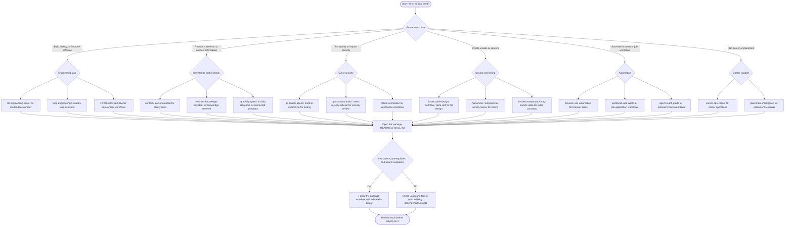

# Personal Plugin Archive

This repository tracks plugin packages owned by the connected Plugin Creator registry. It is not a mirror of every upstream project's complete runtime source code.

## Current inventory

- Plugin Creator registry inventory: 61 plugins (checked 2026-10-26).
- Package directories in this branch: 61.

## Plugin index

- [ml-engineering-suite](plugins/ml-engineering-suite/)
- [web-recon-toolkit](plugins/web-recon-toolkit/)
- [firecrawl-toolkit](plugins/firecrawl-toolkit/)
- [ml-data-quality-labeling](plugins/ml-data-quality-labeling/)
- [ml-model-deployment](plugins/ml-model-deployment/)
- [ml-hyperparameter-optimization](plugins/ml-hyperparameter-optimization/)
- [mlops-pipeline-engineer](plugins/mlops-pipeline-engineer/)
- [ml-model-development](plugins/ml-model-development/)
- [superpowers-workflow](plugins/superpowers-workflow/)
- [gstack-workflow-toolkit](plugins/gstack-workflow-toolkit/)
- [chrome-devtools-agent](plugins/chrome-devtools-agent/)
- [caveman](plugins/caveman/)
- [antigravity-awesome-skills](plugins/antigravity-awesome-skills/)
- [skill-inspector](plugins/skill-inspector/)
- [vercel-skills-workflow](plugins/vercel-skills-workflow/)
- [design-md-guide](plugins/design-md-guide/)
- [taste-skill](plugins/taste-skill/)
- [loop-engineering](plugins/loop-engineering/)
- [ruflo-agent-harness](plugins/ruflo-agent-harness/)
- [openviking-context-plugin](plugins/openviking-context-plugin/)
- [harness-engineering](plugins/harness-engineering/)
- [diagram-design](plugins/diagram-design/)
- [pya-security-audit](plugins/pya-security-audit/)
- [scientific-agent-skills-workflow](plugins/scientific-agent-skills-workflow/)
- [tencentdb-agent-memory](plugins/tencentdb-agent-memory/)
- [browser-use-automation](plugins/browser-use-automation/)
- [arena-skill](plugins/arena-skill/)
- [reticle-verification](plugins/reticle-verification/)
- [beyondseo](plugins/beyondseo/)
- [artemis-android-qa](plugins/artemis-android-qa/)
- [serena-coding-agent](plugins/serena-coding-agent/)
- [context7-documentation](plugins/context7-documentation/)
- [omniroute-operator](plugins/omniroute-operator/)
- [pentagi-security-workflow](plugins/pentagi-security-workflow/)
- [claude-mem-adapter](plugins/claude-mem-adapter/)
- [qa-quality-agent](plugins/qa-quality-agent/)
- [mirofish-simulation-guide](plugins/mirofish-simulation-guide/)
- [wellfound-auto-apply](plugins/wellfound-auto-apply/)
- [ecc-engineering-companion](plugins/ecc-engineering-companion/)
- [graphify-agent](plugins/graphify-agent/)
- [build-your-own-x-guide](plugins/build-your-own-x-guide/)
- [claudex-loop-assistant](plugins/claudex-loop-assistant/)
- [overleaf-helper](plugins/overleaf-helper/)
- [harvey-sales-operator](plugins/harvey-sales-operator/)
- [weknora-knowledge-assistant](plugins/weknora-knowledge-assistant/)
- [slopmonster-writing-review](plugins/slopmonster-writing-review/)
- [api-anything](plugins/api-anything/)
- [archify-diagrams](plugins/archify-diagrams/)
- [career-ops-copilot](plugins/career-ops-copilot/)
- [agent-reach-guide](plugins/agent-reach-guide/)
- [ai-labs-workflows](plugins/ai-labs-workflows/)
- [ai-video-storyboard](plugins/ai-video-storyboard/)
- [codex-security-advisor](plugins/codex-security-advisor/)
- [humanizer](plugins/humanizer/)
- [rea-reverse-engineering](plugins/rea-reverse-engineering/)
- [not-ai](plugins/not-ai/) — missing asset: `assets/composer-icon.png`
- [impeccable-design-workflow](plugins/impeccable-design-workflow/)
- [brag-launch-video](plugins/brag-launch-video/)
- [ian-xiaohei-illustrations](plugins/ian-xiaohei-illustrations/)
- [inbox-intelligence](plugins/inbox-intelligence/)
- [placement-intelligence](plugins/placement-intelligence/)

## Choose a plugin by topic and use case

Use this decision flow to route a task to the most relevant archived plugin. Start with the outcome you need, then choose the matching topic. The named plugins are examples from this inventory; check each package's own instructions and dependencies before use.

### Topic-to-use-case quick guide

| Topic | Example use case | Start with |
|---|---|---|
| Software engineering | Implement a feature, debug code, or improve a development workflow | `ml-engineering-suite`, `ml-model-development`, `loop-engineering` |
| Documentation and knowledge | Find current library guidance or organize retrieved knowledge | `context7-documentation`, `weknora-knowledge-assistant` |
| Diagrams and architecture | Map dependencies, concepts, or system structure | `graphify-agent`, `archify-diagrams`, `diagram-design` |
| QA and testing | Plan test coverage or review an app's behavior | `qa-quality-agent`, `artemis-android-qa`, `reticle-verification` |
| Security | Audit code or structure a security review | `pya-security-audit`, `codex-security-advisor`, `pentagi-security-workflow` |
| UI and visual design | Improve interface consistency and design decisions | `impeccable-design-workflow`, `taste-skill`, `design-md-guide` |
| Writing and media | Review prose or plan video content | `humanizer`, `slopmonster-writing-review`, `ai-video-storyboard` |
| Browser and job automation | Automate browser tasks or organize job-application workflows | `browser-use-automation`, `wellfound-auto-apply` |
| Career and placement | Track career tasks or research placement opportunities | `career-ops-copilot`, `placement-intelligence` |
| Deployment and DevOps | Follow deployment-focused workflows | `vercel-skills-workflow`, `mlops-pipeline-engineer` |

These are routing suggestions based on package names and inventory topics, not guarantees of capability. Confirm each package's `SKILL.md`, manifest, permissions, dependencies, and supported inputs before selecting it. If multiple topics apply, use the narrowest task-specific package first and add supporting packages only when needed.

## Scope and limitations

- Each folder contains the files available through the Plugin Creator package-file interface. These can include manifests, skill instructions, references, support scripts, and assets.
- Upstream repositories remain the source of truth for runtime implementation, dependencies, release history, and files not included in a plugin package.
- Do not commit credentials, API tokens, `.env` files, or other secrets.
- Do not fabricate unavailable binary assets. Restore them from an authoritative package/source distribution or mark them as unavailable.
- Verify each package's license and attribution requirements before redistribution. Presence in this archive does not establish redistribution rights.
- A package inventory can be complete at the directory level and still omit assets that are not accessible through the registry's text-file interface.

## Quality checks

A GitHub Actions workflow runs structural checks for JSON syntax, `SKILL.md` frontmatter, and relative Markdown links. Passing these checks does not prove runtime behavior. Test representative plugins in their intended environment.

## Inventory maintenance

Regenerate this index when the registry inventory changes and record the date of that inventory.
